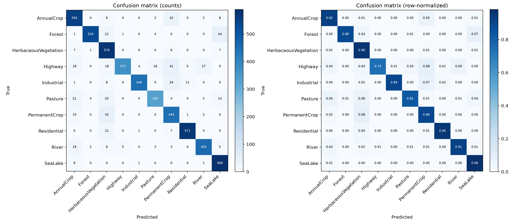

# EuroSAT Satellite Patch Land-Cover Classifier

A web application that classifies 64×64 RGB satellite patches into the 10 [EuroSAT](https://github.com/phelber/EuroSAT) land-cover classes. A MobileNetV2-based model, exported to TensorFlow Lite, runs on CPU inside a Flask service. Every upload and prediction is stored in Supabase (Storage + PostgreSQL) and can be browsed from the UI.

**Live demo:** https://eurosat-satellite-classifier.onrender.com/

> The demo runs on a free Render instance. It spins down when idle, so the first request after inactivity can take a while (cold start).

---

## Features

- Upload a satellite patch, preview it locally, and get the predicted class, confidence, and the full ranked probability list
- CPU-only inference with a ~8.5 MB TensorFlow Lite model, loaded once at startup
- Each upload is saved as a 64×64 JPEG in Supabase Storage with its prediction in PostgreSQL
- Built-in database explorer for `uploaded_patches`, `training_data`, and `test_data`
- Small JSON API, production-served with Gunicorn

## Architecture

```
Browser (index.html + JS)
        │  HTTPS
        ▼
Gunicorn ─► Flask (app.py) ──► TFLite Interpreter (satellite_model.tflite + labels.json)
                  │
                  ├──► Supabase Storage   bucket: satellite-patches
                  └──► Supabase Postgres  uploaded_patches · training_data · test_data

GitHub (main, Git LFS) ──push──► Render (build + host)
```

**Request flow for `POST /api/classify`:** convert to RGB → resize to 64×64 → scale to [0, 1] → run the interpreter → upload JPEG (quality 90) to Storage → insert a row in `uploaded_patches` → return JSON.

## Tech stack

| Layer | Technology |
|---|---|
| Model | MobileNetV2 (ImageNet init, fine-tuned), TensorFlow / TensorFlow Lite |
| Backend | Flask 3.1, Gunicorn 23 |
| Storage / DB | Supabase Storage and PostgreSQL (`supabase-py`) |
| Image handling | Pillow, NumPy |
| Hosting | Render (Python 3, Oregon region), GitHub with Git LFS |

## Project structure

```
.
├── app.py                  # Flask app: routes, TFLite inference, Supabase I/O
├── templates/
│   └── index.html          # Front end (upload, preview, results, DB explorer)
├── satellite_model.tflite  # Exported model (tracked with Git LFS)
├── labels.json             # Class names, same order as the model output
├── requirements.txt
├── evaluate.py             # Computes all evaluation metrics (see Evaluation)
├── train_and_seed.py       # Offline: train, export model, seed Supabase tables
├── .env                    # Local secrets (git-ignored)
└── .gitignore              # excludes dataset/ and .env
```

## Getting started

### Prerequisites

- Python 3
- A Supabase project with a Storage bucket (default name `satellite-patches`) and the tables listed under [Database](#database)
- [Git LFS](https://git-lfs.com/) (the `.tflite` file is an LFS object)

### Run locally

```bash
git clone https://github.com/Zenthoriax/eurosat-satellite-classifier.git
cd eurosat-satellite-classifier
git lfs pull

python -m venv .venv
source .venv/bin/activate        # Windows: .venv\Scripts\activate
pip install -r requirements.txt
```

Create a `.env` file:

```env
SUPABASE_URL=https://<your-project>.supabase.co
SUPABASE_SERVICE_ROLE_KEY=<your-service-role-key>
SUPABASE_BUCKET=satellite-patches
```

Start the server:

```bash
python app.py                                  # http://localhost:8000
# or, as in production:
gunicorn app:app --bind 0.0.0.0:8000
```

The app raises an error at startup if `SUPABASE_URL` or `SUPABASE_SERVICE_ROLE_KEY` is missing.

> **Security:** the service-role key bypasses Row Level Security. Keep it in server-side environment variables only. Never commit `.env` or expose the key to the browser.

### Environment variables

| Variable | Required | Description |
|---|---|---|
| `SUPABASE_URL` | yes | Supabase project URL |
| `SUPABASE_SERVICE_ROLE_KEY` | yes | Service-role key (secret) |
| `SUPABASE_BUCKET` | no | Storage bucket, default `satellite-patches` |
| `PORT` | no | Port for `python app.py` (default 8000); set by Render in production |

## API

| Method | Path | Description |
|---|---|---|
| `GET` | `/` | Web UI |
| `POST` | `/api/classify` | Classify an uploaded image |
| `GET` | `/api/table/<table_name>` | Latest 20 rows of `uploaded_patches`, `training_data`, or `test_data` |

### `POST /api/classify`

`multipart/form-data` with an `image` file field.

```bash
curl -X POST -F "image=@patch.jpg" https://eurosat-satellite-classifier.onrender.com/api/classify
```

```json
{
  "predicted_label": "Forest",
  "confidence": 0.9731,
  "confidence_pct": 97.31,
  "storage_path": "uploads/20260101T120000Z_ab12cd34_patch.jpg",
  "bucket": "satellite-patches",
  "probabilities": [{ "label": "Forest", "score": 0.9731 }, "..."]
}
```

The values above are illustrative. Errors: `400` when no image is sent.

### `GET /api/table/<table_name>`

Returns `{"headers": [...], "rows": [...]}`. Rows are ordered newest first (`created_at` for `uploaded_patches`, `id` for the others), limited to 20. The columns `all_probabilities`, `storage_path`, and `user_id` are hidden. Any other table name returns `400`.

## Model

| Item | Value |
|---|---|
| Input | 64×64×3 RGB, `float32`, scaled to [0, 1] (divide by 255) |
| Backbone | MobileNetV2, `include_top=False`, ImageNet weights, fully trainable |
| Head | GlobalAveragePooling2D → Dropout(0.3) → Dense(10, softmax) |
| Training | Adam, lr 1e-4, sparse categorical cross-entropy; defaults `EPOCHS=8`, `BATCH_SIZE=64` |
| Data | [EuroSAT RGB](https://zenodo.org/records/7711810), 27,000 images, 80/20 stratified split (`random_state=42`): 21,600 train / 5,400 test |
| Export | `TFLiteConverter.from_keras_model`, no quantization, 8.522 MB |

Retrain, re-export, and reseed the Supabase tables with `python train_and_seed.py` (needs `requests` and `scikit-learn` in addition to the requirements).

## Evaluation

`evaluate.py` evaluates the **deployed** `.tflite` model on the exact held-out test split used during training (same file ordering, `test_size=0.2`, `random_state=42`, stratified) with the same preprocessing as `app.py`. It checks that `labels.json` matches the dataset folders before running.

```bash
pip install numpy pillow scikit-learn matplotlib tensorflow-cpu
python evaluate.py --data dataset/EuroSAT_RGB
```

If the dataset folder is missing, the script downloads and extracts EuroSAT RGB (~90 MB) from Zenodo automatically (pass `--no-download` to disable this). It also accepts a folder you already extracted, including the nested `EuroSAT_RGB/EuroSAT_RGB` layout.

Options: `--model`, `--labels`, `--out-dir` (default `evaluation/`), `--warmup`, `--no-download`.

**Outputs** (in `evaluation/`):

| File | Contents |
|---|---|
| `metrics.json` | All metrics below, per-class values, top confusions, environment |
| `classification_report.txt` | scikit-learn report |
| `confusion_matrix.csv` / `.png` | Counts and row-normalized heatmaps |
| `predictions.csv` | Per-image true label, prediction, confidence, correctness |
| `metrics_tables.tex` | `booktabs` tables to `\input{}` into LaTeX |
| `metrics.md` | Markdown tables to paste below |

**Metrics computed:** top-1 and top-3 accuracy, per-class and macro/weighted precision, recall and F1, support, Cohen's κ, Matthews correlation coefficient, mean confidence (overall, correct, incorrect), confusion matrix and top-10 confused class pairs, CPU latency per image (mean, median, p95, p99, min, max; batch size 1, interpreter call only), and model size.

### Results

Evaluated on the 5,400-image held-out EuroSAT test split with the deployed `satellite_model.tflite`:

| Metric | Value |
|---|---|
| Test images | 5,400 |
| Accuracy (top-1) | **90.04%** |
| Macro precision / recall / F1 | 91.05% / 89.51% / **89.87%** |
| Weighted precision / recall / F1 | 90.92% / 90.04% / 90.08% |
| CPU latency, mean / median / p95 (ms per image) | 0.82 / 0.78 / 1.05 |
| Model size | 8.522 MB |

| Class | Precision | Recall | F1 | Support |
|---|---|---|---|---|
| AnnualCrop | 0.8648 | 0.9167 | 0.8900 | 600 |
| Forest | 0.9869 | 0.8817 | 0.9313 | 600 |
| HerbaceousVegetation | 0.7945 | 0.9600 | 0.8694 | 600 |
| Highway | 0.9841 | 0.7420 | 0.8461 | 500 |
| Industrial | 0.9867 | 0.8920 | 0.9370 | 500 |
| Pasture | 0.9296 | 0.8250 | 0.8742 | 400 |
| PermanentCrop | 0.7739 | 0.8900 | 0.8279 | 500 |
| Residential | 0.9711 | 0.9517 | 0.9613 | 600 |
| River | 0.9305 | 0.9100 | 0.9201 | 500 |
| SeaLake | 0.8831 | 0.9817 | 0.9298 | 600 |

**Reading the table**

- Residential has the best F1 (0.9613); PermanentCrop (0.8279) and Highway (0.8461) are the weakest.
- Highway, Forest, and Industrial have very high precision but lower recall: the model rarely predicts them wrongly but misses some true patches (Highway recall 0.7420).
- HerbaceousVegetation and PermanentCrop show the opposite pattern (recall higher than precision), meaning they absorb patches from other classes. See `evaluation/confusion_matrix.png` for where errors go.

**Notes**

- Latency is the interpreter call only (batch size 1, CPU, XNNPACK delegate, image decoding excluded), measured on the author's Windows development machine. Expect different numbers on Render's free instance.
- The test split is also the validation set passed to `model.fit` during training. There is no early stopping or checkpoint selection in `train_and_seed.py`, but it is not an independent third hold-out.
- Top-3 accuracy, Cohen's κ, Matthews correlation, mean confidence, and the top confusions are in `evaluation/metrics.json` after running `evaluate.py`.



## Database

Columns referenced by the application (your schema may include more, e.g. `id`, `created_at`):

| Table | Columns used |
|---|---|
| `uploaded_patches` | `filename`, `storage_path`, `predicted_label`, `confidence`, `all_probabilities`, `created_at` |
| `training_data` | `id`, `filename`, `true_label`, `split` (21,600 rows) |
| `test_data` | `id`, `filename`, `true_label`, `predicted_label`, `confidence`, `is_correct` (5,400 rows) |

Uploaded images are stored in the `satellite-patches` bucket at `uploads/<UTC_TIMESTAMP>_<8-CHAR-UUID>_<SAFE_STEM>.jpg`. The stored image is the resized, JPEG-re-encoded 64×64 patch, not the original upload.

## Deployment (Render)

| Setting | Value |
|---|---|
| Runtime | Python 3 |
| Build command | `pip install -r requirements.txt` |
| Start command | `gunicorn app:app --bind 0.0.0.0:$PORT` |
| Region | Oregon |
| Auto-deploy | On commit to `main` |
| Environment | `SUPABASE_URL`, `SUPABASE_SERVICE_ROLE_KEY`, `SUPABASE_BUCKET` |
| Health check path | blank (no `/healthz` route yet) |

Notes for the free tier: 512 MB RAM, spin-down after inactivity (cold start on the next request), and an ephemeral disk, which is why uploads go to Supabase Storage.

## Limitations

- Inputs are resized to 64×64 RGB; imagery very different from Sentinel-2 EuroSAT patches may be misclassified, and any image is assigned one of the 10 classes
- Softmax confidence is not a calibrated probability of correctness
- Reported metrics use the same split that served as validation data during training
- `tf.lite.Interpreter` is reported as deprecated by TensorFlow; migrating to LiteRT is planned
- No upload size limit, file-type validation, authentication, or rate limiting
- The table explorer endpoints are publicly readable
- Storage upload and database insert are not transactional
- `numpy`, `pillow`, `supabase`, and `tensorflow-cpu` are unpinned in `requirements.txt`

## Roadmap

- [ ] Add `/healthz` and configure the Render health check
- [ ] Input validation and structured error responses
- [ ] Pin all dependencies
- [ ] Rate limiting and pagination for the table explorer
- [x] Publish evaluation results from `evaluate.py`
- [ ] Hold out a separate validation split so the test split is used only for final reporting
- [ ] Migrate from the deprecated `tf.lite.Interpreter` to LiteRT (`ai_edge_litert`)

## Citations

- P. Helber, B. Bischke, A. Dengel, D. Borth, "EuroSAT: A Novel Dataset and Deep Learning Benchmark for Land Use and Land Cover Classification," *IEEE JSTARS*, 12(7), 2217–2226, 2019.
- M. Sandler, A. Howard, M. Zhu, A. Zhmoginov, L.-C. Chen, "MobileNetV2: Inverted Residuals and Linear Bottlenecks," *CVPR*, 2018.

## Author

**Jeevananthan Senthilkumar** ([@Zenthoriax](https://github.com/Zenthoriax)), Jain University, Kochi

## License

No license has been specified yet. Add a `LICENSE` file before reusing or distributing this code.
